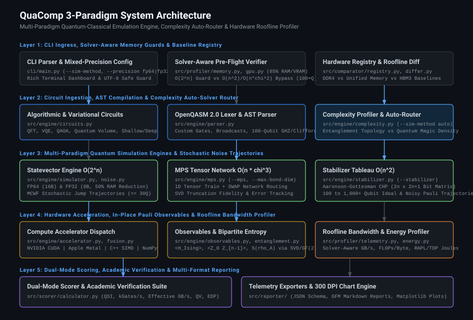
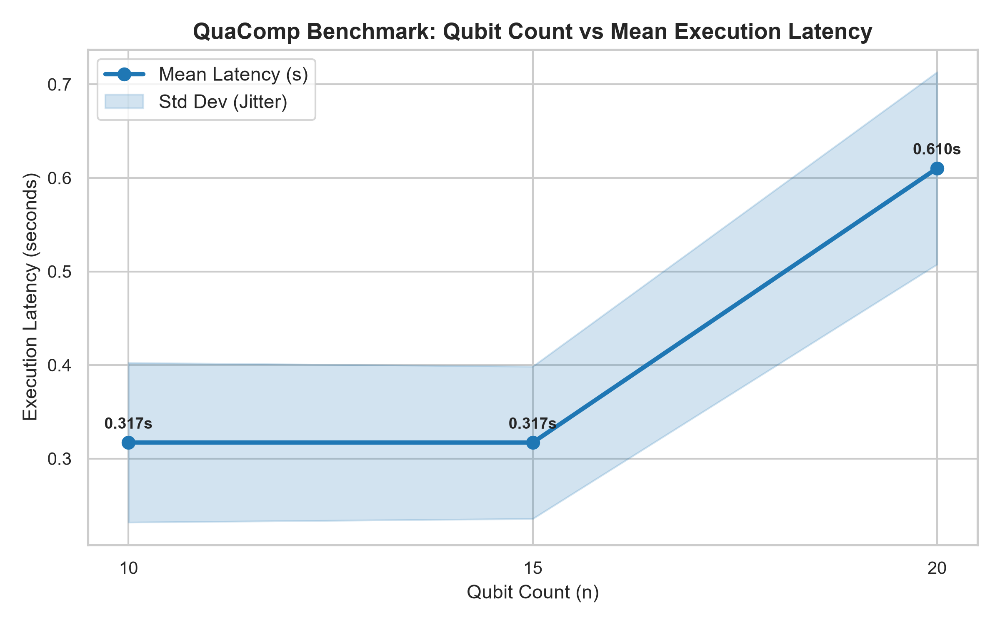
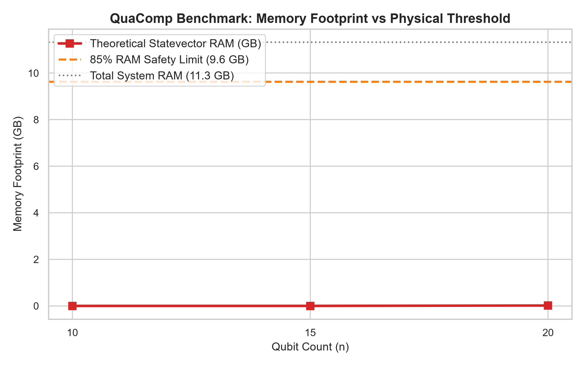

<div align="center">
<pre align="center">
   ____             ____                     
  / __ \__  ______ / ___| ___  _ __ ___  _ __ 
 / / / / / / / __ `/ /   / _ \| '_ ` _ \| '_ \
/ /_/ / /_/ / /_/ / |__| (_) | | | | | | |_) |
\___\_\__,_/\__,_/\____/\___/|_| |_| |_| .__/ 
                                       |_|    
</pre>

# QuaComp

**Multi-Paradigm Quantum-Classical Emulation Engine & Hardware Roofline Profiler**

*Profile, stress-test, and benchmark quantum circuit simulations across Dense Statevector, Matrix Product State (MPS), and Aaronson-Gottesman Stabilizer Tableau engines with automated complexity routing, Roofline bandwidth telemetry, mixed-precision emulation, and stochastic noise trajectories.*

[](https://www.python.org/)
[](https://github.com/cybort18/QuaComp/actions)
[](#running-tests)
[](#running-tests)
[](PRD.md)
[](LICENSE)

</div>

---

## Overview

QuaComp is an open-source Python CLI emulation engine and hardware roofline profiler designed to evaluate the computational limits of classical computers when representing quantum computation across **three complementary solver paradigms**:

1. **Statevector Engine ($\mathcal{O}(2^n)$)**: Exact dense Hilbert-space evolution for circuits with high non-Clifford gate density up to physical RAM capacity ($\sim 28\text{--}30$ qubits), accelerated via C++ SIMD, Apple Metal, and NVIDIA CUDA (`fp64`/`fp32`).
2. **Matrix Product State / MPS Engine ($\mathcal{O}(n \cdot \chi^3)$)**: 1D tensor network train with automated *SWAP network routing* for non-local 2-qubit gates ($|i - j| > 1$) and cumulative *SVD truncation fidelity* tracking for low-to-moderate entanglement circuits beyond 30 qubits.
3. **Stabilizer Tableau Engine ($\mathcal{O}(n^2)$)**: Binary symplectic implementation of the Aaronson-Gottesman CHP algorithm capable of simulating **100 to 1,000+ maximally entangled qubits** (Clifford circuits and noisy Pauli frame Monte Carlo trajectories) in milliseconds.

### Core Scientific & Engineering Capabilities
- **Auto-Solver Complexity Router (`--sim-method auto`)**: Pre-flight static circuit analyzer that profiles *Quantum Magic / T-gate density* against *Entanglement Topology* (`unentangled`, `1D_local`, `volume_law`) to automatically select the optimal solver (`stabilizer`, `mps`, or `statevector`).
- **Multi-Paradigm Observables & Entanglement**: Evaluates 1D transverse-field Ising Hamiltonian energy ($\langle \hat{H}_{\text{Ising}} \rangle$), end-to-end spin correlation ($\langle Z_0 Z_{n-1} \rangle$), and bipartite Von Neumann entanglement entropy ($S(\rho_A)$ in *ebits*) in-place across all three solvers without exponential memory expansion.
- **Solver-Aware Roofline & Mixed-Precision (`--precision {fp64,fp32}`)**: Tracks solver-aware *Effective Memory Bandwidth* (GB/s), *Arithmetic Intensity* (FLOPs/Byte), hardware energy consumption (Joules via Linux RAPL or dynamic TDP), and 50% memory reduction in `fp32` (`complex64`) mode.

---

## System Architecture



*For interactive HTML views of all five system diagrams, open [docs/diagrams/index.html](docs/diagrams/index.html) in any browser.*

---

## Quick Start

### 1. Installation
```bash
git clone https://github.com/cybort18/QuaComp.git
cd QuaComp
pip install -e .
```
*(If a C++ compiler is detected, the native SIMD extension is compiled automatically; otherwise, QuaComp falls back cleanly to pure NumPy/CPython).*

### 2. Multi-Paradigm CLI Examples
```bash
# 1. Quick Benchmark (10, 15, and 20 Qubits) with 300 DPI Telemetry Charts
python -m cli.main --quick --chart

# 2. 100-Qubit Maximally Entangled GHZ Benchmark via Stabilizer Tableau (< 0.05s)
python -m cli.main --qasm benchmarks/ghz_100qubit.qasm --stabilizer --runs 3

# 3. 100-Qubit Noisy Decoherence Simulation via Pauli Frame Propagation
python -m cli.main --qasm benchmarks/ghz_100qubit.qasm --stabilizer --noise-level low --shots 1000

# 4. Auto-Solver Complexity Routing & Mixed-Precision Emulation (50% RAM Reduction)
python -m cli.main --qasm benchmarks/qft_4qubit.qasm --sim-method auto --precision fp32

# 5. Matrix Product State (MPS) with Explicit Bond Dimension & SVD Cutoff
python -m cli.main --qasm benchmarks/teleportation.qasm --mps --max-bond-dim 64 --svd-cutoff 1e-9

# 6. Comparative Roofline Diff Against Reference Hardware Baseline
python -m cli.main --quick --compare --target apple_m3
```

| Execution Latency Scaling (Mean ± Std Dev) | Memory Footprint & RAM Safety Boundary |
| :---: | :---: |
|  |  |

---

## Key Capabilities & Operational Limits

| Capability | QuaComp Implementation | Operational Limit & Complexity Bound |
| :--- | :--- | :--- |
| **Dense Statevector** | `complex128` (`fp64`) or `complex64` (`fp32`) state evolution | O(2^n × 16 B) or O(2^n × 8 B). Practical ceiling: ~28–30 qubits on 16–32 GB RAM. |
| **MPS Tensor Network** | 1D tensor chain with SWAP routing & truncated SVD | O(n · χ^3) time, O(n · χ^2) memory. Tracks cumulative SVD fidelity F_mps. |
| **Stabilizer Tableau** | Aaronson-Gottesman 2n × (2n + 1) binary symplectic matrix | O(n^2) memory (< 10 KB for 100 qubits). Exact for Clifford circuits up to 1,000+ qubits. |
| **Auto-Solver Router** | Static profiler for Magic Density vs. Entanglement Topology | Automatically dispatches circuits to `stabilizer`, `mps`, or `statevector`. |
| **Stochastic Noise Engine** | MCWF statevector jumps O(2^n) & Pauli frame stabilizer trajectories O(n^2) | Bypasses the O(4^n) density matrix wall; supports noisy 100+ qubit Clifford runs. |
| **In-Place Observables** | Pauli string ⟨P⟩, Ising energy ⟨H_Ising⟩, and bipartite entropy S(ρ_A) | Evaluated via bitwise indexing, MPS transfer matrices, or GF(2) symplectic rank. |
| **Roofline Bandwidth** | Solver-aware Effective Memory Bandwidth (GB/s) & Arithmetic Intensity | 0.4375 FLOPs/B (Statevector), 2.0 FLOPs/B (MPS), 0.25 FLOPs/B (Stabilizer). |
| **Hardware Acceleration** | NVIDIA CUDA (`fusion.cu`), Apple Metal (`fusion.metal`), C++ SIMD, NumPy | 4-tier graceful fallback guarantees 100% execution across Linux, macOS, and Windows. |

---

## Architectural & Methodological Diagrams

1. **[3-Paradigm System Architecture](docs/images/architecture.svg)**: CLI ingress, Complexity Auto-Router, 3-paradigm engines, in-place observables, and Roofline profiler.
2. **[Benchmark Execution Lifecycle](docs/images/benchmark-workflow.svg)**: Seven-stage execution pipeline from pre-flight memory guards to statistical distribution reporting.
3. **[Auto-Solver Router & Backend Dispatch](docs/images/backend-selection.svg)**: Two-stage algorithmic solver routing and 4-tier hardware accelerator fallback.
4. **[Three-Paradigm Simulation Engines](docs/images/statevector-vs-mps.svg)**: Structural comparison of Statevector O(2^n), MPS O(n · χ^3), and Stabilizer Tableau O(n^2).
5. **[Noise Simulation Workflow](docs/images/noise-workflow.svg)**: Stochastic MCWF jump trajectories and Pauli frame propagation versus density matrix evolution.

---

## Command Flags Reference

| Flag | Argument / Default | Description |
| :--- | :--- | :--- |
| `--quick` | None | Runs quick benchmark suite across 10, 15, and 20 qubits. |
| `--full` | None | Incremental stress test starting from 10 qubits up to RAM safety limit. |
| `--custom` | None | Custom simulation mode with user-defined parameters. |
| `--qubits` | `INT` (default: `10`) | Number of active qubits for synthetic circuit generation. |
| `--type` | `shallow`, `deep`, `qft`, `vqe`, `qaoa`, `qv` | Synthetic circuit workload type (default: `qft`). |
| `--sim-method` | `auto`, `statevector`, `mps`, `stabilizer` | Simulation paradigm or automated complexity routing (alias: `--method`). |
| `--stabilizer` | None | Shorthand flag to enable O(n^2) Aaronson-Gottesman Stabilizer Tableau mode. |
| `--mps` | None | Shorthand flag to enable native Matrix Product State (MPS) tensor network mode. |
| `--max-bond-dim` | `INT` (default: `64`) | Maximum bond dimension χ_max for SVD truncation in MPS (alias: `--bond-dim`). |
| `--svd-cutoff` | `FLOAT` (default: `1e-9`) | Singular value truncation threshold for MPS SVD compression. |
| `--precision` | `fp64`, `fp32` (default: `fp64`) | Numerical precision: `fp64` (`complex128`) or `fp32` (`complex64`, 50% RAM savings). |
| `--backend` | `auto`, `cuda`, `metal`, `cpp`, `numpy` | Compute accelerator backend with automatic multi-tier fallback. |
| `--noise-level` | `none`, `low`, `medium`, `high` | NISQ synthetic decoherence preset level (default: `none`). |
| `--noise-method` | `trajectory`, `density_matrix` | Stochastic trajectory sampling (default) or O(4^n) density matrix evolution. |
| `--shots` | `INT` (default: `1000`) | Number of stochastic quantum trajectories or measurement shots. |
| `--noise-profile` | `PATH` or alias | Ingest physical QPU calibration snapshot (e.g., `ibm_brisbane_sample`). |
| `--qasm` | `PATH` | Path to OpenQASM 2.0 file (`.qasm`) to parse and benchmark. |
| `--entropy` | None | Compute detailed Schmidt rank and simulation hardness classification. |
| `--compare` | `[FILE1] [FILE2]` | Differential Roofline & latency comparison against reference baselines. |
| `--target` | `apple_m3`, `ryzen3_5300u`, `nvidia_h100`, etc. | Target reference baseline alias or JSON path for `--compare`. |
| `--runs` | `INT` (default: `3`) | Benchmark iterations per circuit for Mean ± Std Dev latency statistics. |
| `--chart` | None | Generate 300 DPI telemetry PNG charts in output directory. |
| `--export` | `json`, `md`, `all` (default: `all`) | Report export format. |
| `--output-dir` | `PATH` (default: `results`) | Output directory for generated reports and charts. |

---

## Scientific Methodology & Mathematical Foundations

### 1. Three-Paradigm State Representations & Entanglement Entropy
- **Statevector ($\mathcal{O}(2^n)$)**: Stores exact amplitudes $|\psi\rangle \in \mathbb{C}^{2^n}$ in `complex128` (`fp64`) or `complex64` (`fp32`).
- **Matrix Product State ($\mathcal{O}(n \cdot \chi^3)$)**: Factorizes the state into a 1D chain of rank-3 site tensors with SWAP network routing for non-adjacent gates and tracks cumulative SVD truncation fidelity:

$$F_{\text{MPS}} = \prod_{k} \left( 1 - \sum_{i > \chi_{\max}} \lambda_{k,i}^2 \right)$$

- **Stabilizer Tableau ($\mathcal{O}(n^2)$)**: Represents $n$-qubit Clifford states via a $2n \times (2n + 1)$ binary matrix over $\text{GF}(2)$ tracking $n$ destabilizers and $n$ stabilizers. Bipartite entanglement entropy across cut $A \cup B$ is computed directly from the $\text{GF}(2)$ binary rank of the cross-partition anticommutation submatrix without statevector expansion:

$$S(\rho_A) = \frac{1}{2} \text{rank}_{\text{GF}(2)}\left( G_A \Omega G_A^T \right) \quad \text{(in ebits)}$$

### 2. In-Place Pauli Expectations & 1D Ising Hamiltonian
Across all three solvers, QuaComp evaluates expectation values $\langle \psi | \hat{H} | \psi \rangle$ for Pauli strings $P \in \{I, X, Y, Z\}^{\otimes n}$ and the 1D transverse-field Ising Hamiltonian:

$$\hat{H}_{\text{Ising}} = -J \sum_{i=0}^{n-2} Z_i Z_{i+1} - h \sum_{i=0}^{n-1} X_i$$

using $\mathcal{O}(2^n)$ bitwise XOR/popcount indexing on statevectors, $\mathcal{O}(n \cdot \chi^3)$ local transfer-matrix contractions on MPS, and $\mathcal{O}(n^2)$ symplectic row-reduction in the Stabilizer Tableau.

### 3. Solver-Aware Roofline Model & Dual-Mode Scoring
Effective memory bandwidth is derived from each solver's exact byte traffic per gate:

$$\text{Bandwidth}_{\text{eff}} = \frac{\text{Bytes Transferred}(\text{solver}, n, \chi, \text{precision})}{\mu_{\text{latency}} \times 10^9} \quad (\text{GB/s})$$

- **QuaComp Synthetic Index (QSI)**:

$$\text{QSI} = \text{round}\left( n_{\text{qubits}} \cdot \left[ 100.0 + 50.0 \cdot \log_{10}(\max(T, 1.0)) + 25.0 \cdot \left(\frac{\text{Fidelity}}{100}\right) \right], 2 \right)$$

---

## Running Tests

QuaComp maintains a 100% pass rate across 279 unit tests (`1 skipped` for live NVIDIA CUDA hardware when executed on non-CUDA hosts):

```bash
python -m pytest tests/ -v
```

---

## Reference Hardware Baselines

| Reference Platform | Memory | Device | Peak Roofline Bandwidth | Sample Baseline Profile |
| :--- | :---: | :---: | :---: | :--- |
| **AMD Ryzen 3 5300U** | 11.33 GB DDR4 | CPU | 3.55 GB/s | [`example_ryzen3_5300u.json`](results/registry/example_ryzen3_5300u.json) |
| **AMD Ryzen 7 5800H** | 16.00 GB DDR4 | CPU | 14.32 GB/s | [`example_ryzen7_5800h.json`](results/registry/example_ryzen7_5800h.json) |
| **Apple M3 (8-core)** | 24.00 GB Unified | CPU / Metal | 46.89 GB/s | [`example_apple_m3.json`](results/registry/example_apple_m3.json) |
| **Apple M4 Max** | 128.00 GB Unified | Metal | 357.63 GB/s | [`example_apple_m4_max.json`](results/registry/example_apple_m4_max.json) |
| **AWS Graviton4** | 32.00 GB DDR5 | CPU | 89.41 GB/s | [`example_aws_graviton4.json`](results/registry/example_aws_graviton4.json) |
| **NVIDIA H100 (80GB)** | 80.00 GB HBM3 | CUDA | 1,788.14 GB/s | [`example_nvidia_h100.json`](results/registry/example_nvidia_h100.json) |

---

## Project Structure

```text
QuaComp/
├── benchmarks/             # OpenQASM 2.0 circuits (Bell, QFT, Teleportation, 100-Qubit GHZ)
│   └── ghz_100qubit.qasm   # 100-qubit maximally entangled Clifford benchmark
├── cli/                    # CLI argument parser, solver router integration, and Rich UI
├── docs/
│   ├── diagrams/           # Interactive HTML viewer for architectural diagrams
│   └── images/             # Vector schematics (SVG) and 300 DPI telemetry plots (PNG)
├── results/
│   ├── noise_profiles/     # Physical QPU calibration snapshots (e.g., IBM Brisbane 127Q)
│   └── registry/           # Reference hardware baselines with Roofline bandwidth metrics
├── src/
│   ├── comparator/         # Differential Roofline & latency comparison engine
│   ├── engine/             # 3-Paradigm Core (simulator.py, mps.py, stabilizer.py,
│   │                       #   complexity.py, observables.py, entanglement.py, noise.py)
│   ├── profiler/           # Solver-aware Roofline telemetry, memory guards, energy profiler
│   ├── reporter/           # JSON/Markdown exporters and Matplotlib chart generator
│   └── scorer/             # QSI heuristic calculator and Academic Verification Suite
└── tests/                  # 25 test suites (279 passed, 1 skipped)
```

---

## Contribution Guide & License

1. Adhere to the engineering and GFM mathematical formatting rules in [AGENTS.md](AGENTS.md) and [GEMINI.md](GEMINI.md).
2. Maintain zero emojis / emotes across source code, docstrings, CLI output, and documentation.
3. Verify `python -m pytest -v`, `python -m cli --help`, and `python -m cli --quick` before submitting changes.

For full architectural specifications and functional requirements (`FR-1` through `FR-24`), consult [PRD.md](PRD.md).

Licensed under the **MIT License** — see [LICENSE](LICENSE) for details.
