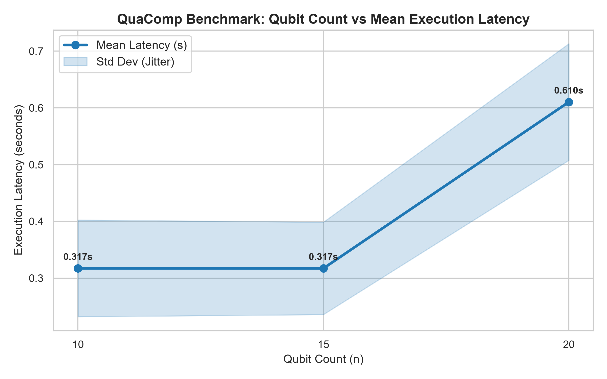
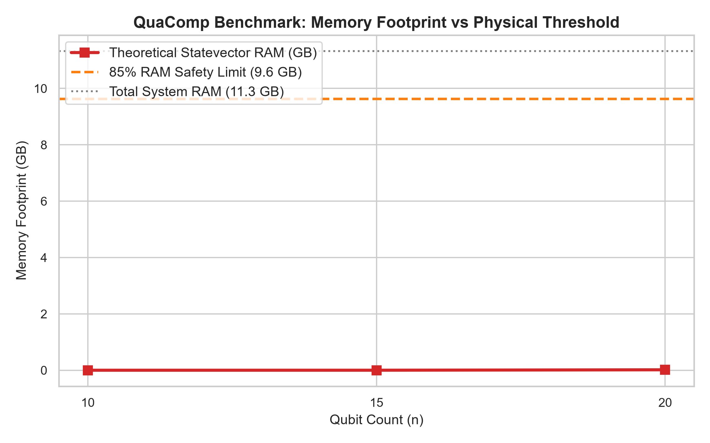

<div align="center">
<pre align="center">
   ____             ____                     
  / __ \__  ______ / ___| ___  _ __ ___  _ __ 
 / / / / / / / __ `/ /   / _ \| '_ ` _ \| '_ \
/ /_/ / /_/ / /_/ / |__| (_) | | | | | | |_) |
\___\_\__,_/\__,_/\____/\___/|_| |_| |_| .__/ 
                                       |_|    
</pre>

# QuaComp

**Quantum Computing Simulation Benchmark on Local Hardware**  
*Profile and benchmark quantum circuit simulations across statevector and Matrix Product State (MPS) representations with native GPU/SIMD acceleration, Monte Carlo trajectory noise, and automated memory management.*

[](https://www.python.org/)
[](https://github.com/cybort18/QuaComp/actions)
[](#running-tests)
[](PRD.md)
[](LICENSE)

</div>

---

## Table of Contents
- [Quick Start](#quick-start)
- [Key Capabilities](#key-capabilities)
- [Common CLI Usage](#common-cli-usage)
- [Hardware Compatibility Matrix](#hardware-compatibility-matrix)
- [Command Flags Reference](#command-flags-reference)
- [Architecture & Scientific Methodology](#architecture--scientific-methodology)
  - [1. Monte Carlo Wavefunction (MCWF) Trajectory Noise Formalism](#1-monte-carlo-wavefunction-mcwf-trajectory-noise-formalism)
  - [2. Native Kernel Acceleration & Multi-Tier Fallback Hierarchy](#2-native-kernel-acceleration--multi-tier-fallback-hierarchy)
  - [3. Tensor Network Matrix Product State (MPS) & Entanglement Entropy](#3-tensor-network-matrix-product-state-mps--entanglement-entropy)
  - [4. Scoring Engine: QuaComp Synthetic Index (QSI) & Academic Suite](#4-scoring-engine-quacomp-synthetic-index-qsi--academic-suite)
  - [5. Project Repository Architecture](#5-project-repository-architecture)
- [Running Tests](#running-tests)
- [Reference Hardware Benchmarks](#reference-hardware-benchmarks)
- [Contribution Guide & License](#contribution-guide--license)

---

## Quick Start

### 1. Install QuaComp
```bash
# Clone the repository
git clone https://github.com/cybort18/QuaComp.git
cd QuaComp

# Install in editable mode (auto-compiles C++ extension if MSVC/GCC/Clang is available)
pip install -e .
```
*(If a C++ compiler is not present, QuaComp automatically uses the vectorized NumPy/CPython implementation).*

### 2. Run Your First Benchmark
```bash
# Run a quick 10, 15, and 20 qubit benchmark with automatic telemetry plot generation
quacomp --quick --chart
```

Benchmark plots are saved at 300 DPI in `results/`:

| Execution Latency Scaling (Mean ± Std Dev) | Memory Footprint & RAM Safety Threshold |
| :---: | :---: |
|  |  |

---

## Key Capabilities

| Dimension / Feature | QuaComp Implementation | Standard Approach / Context |
| :--- | :--- | :--- |
| **Noise Simulation** | **Monte Carlo Wavefunction (MCWF)**: O(2^n) memory, up to 28 qubits on 16 GB RAM | Density Matrix O(4^n) typically exceeds available RAM beyond 14–15 qubits |
| **Hardware Acceleration** | Multi-tier: NVIDIA CUDA (`fusion.cu`), Apple Metal (`fusion.metal`), C++ SIMD, NumPy fallback | Often single-backend or lacks automated multi-tier fallback |
| **Memory Safety** | Pre-flight RAM & VRAM guard (85% RAM limit, 90% VRAM headroom) | Unchecked allocations may cause out-of-memory errors or system termination |
| **Large-Scale Circuits** | Matrix Product State (MPS, bond dimension χ ≤ 128) for low-entanglement circuits | Statevector memory scales exponentially (exceeding ~16 GB at 30 qubits) |
| **Standard Circuit Input** | Built-in OpenQASM 2.0 parser & bi-directional Qiskit conversion | Often requires external converter scripts |
| **Benchmarking Metrics** | Dual-Mode Scoring: QSI (hardware index) & Academic Suite (kGates/s, QV, EDP) | Often limited to single-dimension metrics (such as wall-clock time) |
| **Energy Profiling** | Hardware energy profiling (Linux RAPL microjoules / Windows Dynamic TDP) | Energy telemetry typically not integrated |

---

## Common CLI Usage

```bash
# 1. Quick Benchmark with Telemetry Plots
quacomp --quick --chart

# 2. NVIDIA CUDA Acceleration with Gate Fusion
quacomp --custom --qubits 24 --backend cuda

# 3. Monte Carlo Wavefunction Quantum Trajectories (1000 Shots)
quacomp --custom --qubits 20 --noise-level medium --noise-method trajectory --shots 1000

# 4. Physical QPU Noise Calibration (IBM Brisbane Snapshot)
quacomp --quick --noise-profile ibm_brisbane_sample

# 5. Simulate 50-Qubit Circuit with Matrix Product State (MPS)
quacomp --custom --qubits 50 --method mps --bond-dim 64

# 6. Benchmark an OpenQASM 2.0 Circuit File
quacomp --qasm benchmarks/bell_state.qasm --runs 3

# 7. Quantum Volume Benchmark with Heavy Output Probability
quacomp --custom --qubits 4 --qv

# 8. Compare Local Machine Performance Against a Reference Baseline
quacomp --quick --compare --target apple_m4_max
```

> *Note: Execution can also be invoked via `python -m cli`.*

---

## Hardware Compatibility Matrix

| Hardware Platform | Accelerator Engine | Runtime Technology | Supported OS | Graceful Fallback Mode |
| :--- | :--- | :--- | :--- | :--- |
| **NVIDIA GPU (RTX / A100 / H100)** | CUDA GPU Acceleration | Native CUDA (fusion.cu) & CuPy/PyTorch | Linux, Windows | C++ SIMD → CPython / NumPy |
| **Apple Silicon (M1/M2/M3/M4)** | Metal GPU Compute | Apple Metal Shaders (fusion.metal) | macOS | C++ SIMD → CPython / NumPy |
| **x86_64 / ARM64 CPU (Modern)** | C++ Native SIMD | Pybind11 Unrolled Matrix Fusion | Linux, macOS, Windows | Pure CPython / NumPy |
| **Any Generic CPU** | Pure CPython / NumPy | Vectorized NumPy Fallback Engine | All Platforms | Built-in Base Level |

---

## Command Flags Reference

| Flag | Options / Default | Description |
| :--- | :--- | :--- |
| `--quick` | N/A | Runs benchmark suite on 10, 15, and 20 qubits. |
| `--full` | N/A | Incremental stress test starting from 10 qubits. |
| `--custom` | N/A | Custom simulation mode with specific qubit parameters. |
| `--qubits` | `INT` (default: `10`) | Qubit count for custom simulation run. |
| `--type` | `shallow`, `deep`, `qft`, `vqe`, `qaoa`, `qv` | Quantum circuit workload type. |
| `--backend` | `auto`, `cuda`, `metal`, `cpp`, `numpy` (default: `auto`) | Compute accelerator backend selection with graceful multi-tier fallback. |
| `--use-native-kernels` | N/A | Force native kernel acceleration (C++ SIMD / Apple Metal / CUDA Gate Fusion). |
| `--method` | `statevector`, `mps` (default: `statevector`) | Simulation engine method. |
| `--bond-dim` | `INT` (default: `64`) | Maximum bond dimension for MPS tensor network engine. |
| `--noise-level` | `none`, `low`, `medium`, `high` (default: `none`) | NISQ synthetic noise preset level. |
| `--noise-method` | `trajectory`, `density_matrix` (default: `trajectory`) | Noise simulation method: Monte Carlo Wavefunction (O(2^n) memory) or Density Matrix (O(4^n), n ≤ 15). |
| `--shots` | `INT` (default: `1000`) | Number of stochastic quantum trajectories for Monte Carlo ensemble averaging. |
| `--noise-profile` | `PATH` or alias | Ingest real physical QPU noise calibration profile with analytical Kraus representation. |
| `--qasm` | `PATH` | Path to OpenQASM 2.0 file (`.qasm`) for standard circuit benchmark ingestion. |
| `--entropy` | N/A | Calculates bipartite Von Neumann entanglement entropy (supports MPS for low-entanglement circuits). |
| `--compare` | `[FILE1] [FILE2]` | Side-by-side relative benchmark comparison between two JSON runs or against a live run. |
| `--target` | `apple_m3`, `apple_m4_max`, `nvidia_h100`, etc. | Target reference baseline alias or file path for `--compare`. |
| `--fetch-baselines` | N/A | Synchronizes reference comparison baselines from QuaComp repository registry. |
| `--workers` | `INT` (default: `1`) | Parallel distributed worker threads/processes for batch trajectory sampling. |
| `--runs` | `INT` (default: `3`) | Number of benchmark iterations per circuit for statistical mean/std calculation. |
| `--chart` | N/A | Automatically generates PNG telemetry chart plots in `results/`. |
| `--export` | `json`, `md`, `all` (default: `all`) | Benchmark report output format. |

---

## Architecture & Scientific Methodology

Click any section below to expand in-depth mathematical formulations and architectural designs:

<details>
<summary><b>1. Monte Carlo Wavefunction (MCWF) Trajectory Noise Formalism</b></summary>

### The Density Matrix Memory Barrier
Standard open quantum systems model noisy evolution via the density matrix $\rho$ of size $2^n \times 2^n = \mathcal{O}(4^n)$. On a 16 GB RAM computer, this causes an immediate Out-Of-Memory wall at only 14–15 qubits:

| Qubits (n) | Statevector (O(2^n), Trajectory) | Density Matrix (O(4^n), Classical) | Feasibility on 16 GB RAM |
| :---: | :---: | :---: | :--- |
| **10** | 16 KB | 16 MB | Low memory footprint for both methods |
| **14** | 256 KB | 4 GB | Practical limit for density matrix on standard systems |
| **16** | 1.05 MB | 64 GB | Density matrix exceeds 16 GB RAM (Blocked by pre-flight guard) |
| **20** | 16.78 MB | 16 TB | Supported via statevector trajectory scaling |
| **24** | 268.44 MB | 4.3 PB | Supported via statevector trajectory scaling |
| **28** | 4.29 GB | 1,099.5 PB | Supported on 16 GB RAM systems |

### Stochastic Kraus Sampling & Non-Unitary No-Jump Drift
For each quantum gate $U$ with Kraus operators $\{K_0, K_1, \dots, K_m\}$ where $\sum_k K_k^\dagger K_k = I$:

**1. Branch Probability Evaluation**:

$$p_k = \langle \psi | K_k^\dagger K_k | \psi \rangle$$

**2. Quantum Jump Selection & Renormalization**:
A uniform random variable $r \in [0, 1)$ is drawn:
- **Jump Branch ($K_1$)**: For amplitude damping, if $r < p_{\text{jump}} = \gamma \cdot p_1$ where $\gamma = 1 - e^{-t_g / T_1}$ and $p_1 = \sum_{\text{target}=1} |\psi|^2$, the target state $|1\rangle$ is collapsed to $|0\rangle$:

$$|\psi'\rangle = \frac{|\psi_{\text{jump}}\rangle}{\sqrt{\langle \psi_{\text{jump}} | \psi_{\text{jump}} \rangle}}$$

- **No-Jump Drift Branch ($K_0$)**: If $r \ge p_{\text{jump}}$, the state undergoes coherent non-unitary drift via $K_0 = \text{diag}(1, \sqrt{1 - \gamma})$, shrinking the $|1\rangle$ amplitude by $\sqrt{1 - \gamma}$ followed by renormalization:

$$|\psi'\rangle = \frac{|\psi_{\text{no-jump}}\rangle}{\sqrt{\langle \psi_{\text{no-jump}} | \psi_{\text{no-jump}} \rangle}}$$

**3. Ensemble Averaging**:
Across $N_{\text{shots}}$ independent trajectories distributed via `ProcessPoolExecutor` with orthogonal `SeedSequence.spawn()` streams:

$$\langle O \rangle = \frac{1}{N_{\text{shots}}} \sum_{s=1}^{N_{\text{shots}}} \langle \psi_s | O | \psi_s \rangle$$

</details>

<details>
<summary><b>2. Native Kernel Acceleration & Multi-Tier Fallback Hierarchy</b></summary>

### Single-Pass Gate Fusion
QuaComp scans circuit DAGs to identify sequential 1-qubit and 2-qubit operations acting on identical or adjacent qubit channels, fusing them into a single compound unitary:

$$U_{\text{fused}} = U_k \times U_{k-1} \times \dots \times U_1$$

### Native Compute Engine Pipeline
1. **NVIDIA CUDA Engine (`src/engine/cuda/fusion.cu`)**: Custom CUDA kernels manipulating 128-bit `cuDoubleComplex` with coalesced memory access, pre-flight VRAM headroom checking, and fallback to CPU upon memory limits.
2. **Apple Metal Engine (`src/engine/shaders/fusion.metal`)**: MSL compute pipeline executing unitary gate fusion on Apple Silicon GPU unified memory.
3. **C++ SIMD Extension (`quacomp_cpp`)**: Pybind11-compiled unrolled complex matrix arithmetic.
4. **CPython / NumPy Fallback**: Vectorized array operations providing baseline compatibility across platforms.

</details>

<details>
<summary><b>3. Tensor Network Matrix Product State (MPS) & Entanglement Entropy</b></summary>

### MPS Linear Tensor Network
Represents the quantum statevector as an entangled chain of tensors:

$$|\psi\rangle = \sum_{i_1, \dots, i_n} A^{[1] i_1} A^{[2] i_2} \dots A^{[n] i_n} |i_1 \dots i_n\rangle$$

Bond dimension $\chi$ is dynamically truncated via Singular Value Decomposition (SVD), compressing state memory from $2^n \times 16$ bytes down to $\mathcal{O}(n \cdot \chi^2)$ bytes for low-entanglement quantum states.

### Bipartite Von Neumann Entanglement Entropy

$$S(\rho_A) = -\text{Tr}(\rho_A \log_2 \rho_A) = -\sum_{i=1}^{\chi} \lambda_i^2 \log_2(\lambda_i^2)$$

Schmidt rank and participation ratio:

$$K = \frac{1}{\sum_{i=1}^{\chi} \lambda_i^4}$$


</details>

<details>
<summary><b>4. Scoring Engine: QuaComp Synthetic Index (QSI) & Academic Suite</b></summary>

### QuaComp Synthetic Index (QSI)
For engineering comparisons and hardware tier ranking, QuaComp computes the **QuaComp Synthetic Index (QSI)** using a balanced logarithmic scale:

$$\text{QSI} = \text{round}\left( n_{\text{qubits}} \cdot \left[ 100.0 + 50.0 \cdot \log_{10}(\max(T, 1.0)) + 25.0 \cdot \left(\frac{\text{Fidelity}}{100}\right) \right], 2 \right)$$

where $n_{\text{qubits}}$ is the maximum qubit capacity simulated, and $T$ is gate throughput in gates/second.

| Tier Category | Score Range (Points) | Max Qubits Simulation Range |
| :--- | :--- | :--- |
| **Entry-Level** | < 2,500 | Up to ~10-12 Qubits |
| **Mid-Range** | 2,500 to 6,000 | ~14-22 Qubits |
| **High-Performance** | 6,000 to 10,000 | ~24-30 Qubits (Fast SIMD / GPU) |
| **Extreme Workstation** | ≥ 10,000 | 30+ Qubits / Advanced MPS |

### Formal Academic Verification Suite
For peer-reviewed scientific publications, reference QuaComp's exported formal metrics:
- **Normalized Gate Throughput**: Measured in thousands of gates per second (kGates/s).
- **Quantum Volume Certification ($h_{\text{prob}} > 2/3$)**: Verified per Cross et al. (2019) with binomial $2\sigma$ confidence bounds ($h_{\text{prob}} - 2\sigma > 2/3$).
- **Energy-Delay Product (EDP)**: Figure-of-merit in Joule-seconds ($J \cdot s$) combining execution latency with hardware RAPL microjoule counters or dynamic TDP modeling.

</details>

<details>
<summary><b>5. Project Repository Architecture</b></summary>

```text
QuaComp/
├── benchmarks/             # Standard OpenQASM 2.0 fixtures (Bell, GHZ, QFT, Teleportation)
├── cli/                    # CLI dispatcher, runners (Quick, Full, Custom), and comparison UI
├── results/
│   ├── noise_profiles/     # Physical QPU calibration snapshots (IBM Brisbane 127Q)
│   └── registry/           # Reference hardware benchmark baselines (Apple M3/M4, Ryzen, H100)
├── src/
│   ├── comparator/         # Relative comparison engine and reference baseline registry
│   ├── engine/
│   │   ├── accelerator.py  # Unified GPU (Metal/CUDA) and C++ accelerator dispatcher
│   │   ├── circuits.py     # Procedural workloads (Shallow, Deep, QFT, VQE, QAOA, QV)
│   │   ├── cpp/            # C++ SIMD native extension (Pybind11 unrolled gate fusion)
│   │   ├── cuda/           # NVIDIA CUDA GPU kernels (fusion.cu, fusion.cuh)
│   │   ├── entanglement.py # Von Neumann entropy & MPS topological router
│   │   ├── mps.py          # Matrix Product State engine & RAM savings profiler
│   │   ├── noise.py        # MCWF trajectory noise model & in-place statevector kernels
│   │   ├── parser.py       # Built-in OpenQASM 2.0 parser & AST evaluator
│   │   ├── physical_noise.py # Physical QPU noise ingestion & Kraus generator
│   │   └── simulator.py    # Aer Simulator wrapper & multi-worker trajectory runner
│   ├── profiler/           # Hardware energy (RAPL/TDP), pre-flight RAM/VRAM guard, and telemetry
│   ├── scorer/             # Dual-mode scoring engine (QSI & Academic Verification Suite)
│   └── reporter/           # 300 DPI chart generator, JSON & Markdown report exporters
└── tests/                  # 204 unit tests covering 100% of engine features
```

</details>

---

## Running Tests

QuaComp maintains 100% test coverage across all features with `pytest`:

```bash
python -m pytest
```

```text
============================= test session starts =============================
platform win32 -- Python 3.13.3, pytest-9.1.1, pluggy-1.6.0
rootdir: C:\Users\HP\Documents\PROJECT\QuaComp
configfile: pyproject.toml
plugins: anyio-4.14.2
collected 204 items

tests\test_accelerator.py .......                                        [  3%]
tests\test_charts.py ....                                                [  5%]
tests\test_comparator.py .......                                         [  8%]
tests\test_cpp_fusion.py ...........                                     [ 14%]
tests\test_cuda.py ..........s............                               [ 25%]
tests\test_energy.py ....                                                [ 27%]
tests\test_engine.py ......                                              [ 30%]
tests\test_entanglement.py ...........                                   [ 35%]
tests\test_gpu.py ...........                                            [ 41%]
tests\test_memory.py .......                                             [ 44%]
tests\test_model_parallelism.py .....                                    [ 47%]
tests\test_mps.py ....                                                   [ 49%]
tests\test_mps_topology.py .....                                         [ 51%]
tests\test_native_integration.py .....                                   [ 53%]
tests\test_noise.py ............                                         [ 59%]
tests\test_parser.py ................................                    [ 75%]
tests\test_physical_noise.py ..........                                  [ 80%]
tests\test_registry.py ...........                                       [ 85%]
tests\test_reporter.py .........                                         [ 90%]
tests\test_scorer.py ...........                                         [ 95%]
tests\test_ui.py ....                                                    [ 97%]
tests\test_variational_qv.py .....                                       [100%]

================== 203 passed, 1 skipped in 61.14s (0:01:01) ==================
```

---

## Reference Hardware Benchmarks

Sample benchmark telemetry profiles are committed in `results/registry/`:

| Reference Machine | RAM | Max Qubits (SV) | QuaComp Synthetic Index (QSI) | Tier Category | Sample Data |
| :--- | :---: | :---: | :---: | :---: | :--- |
| **AMD Ryzen 3 5300U** | 11.33 GB | 20 Qubits | `5,248.15` pts | Mid-Range | [`example_ryzen3_5300u.json`](results/registry/example_ryzen3_5300u.json) |
| **AMD Ryzen 7 5800H** | 16.00 GB | 24 Qubits | `7,812.40` pts | High-Performance | [`example_ryzen7_5800h.json`](results/registry/example_ryzen7_5800h.json) |
| **Apple M3 (8-core)** | 24.00 GB | 25 Qubits | `8,450.60` pts | High-Performance | [`example_apple_m3.json`](results/registry/example_apple_m3.json) |
| **Apple M4 Max** | 128.00 GB | 30 Qubits | `12,890.30` pts | Extreme Workstation | [`apple_m4_max.json`](results/registry/apple_m4_max.json) |

---

## Contribution Guide & License

Contributions are welcome! Please follow these steps:
1. Fork the project.
2. Create your feature branch (`git checkout -b feature/new-feature`).
3. Verify all tests pass (`python -m pytest`).
4. Commit your changes (`git commit -m 'feat: add new feature'`).
5. Push to the branch (`git push origin feature/new-feature`) and open a Pull Request.

For detailed technical specifications and design directives, refer to the [Product Requirement Document (PRD.md)](PRD.md).

This project is licensed under the **MIT License** — see the [LICENSE](LICENSE) file for details.
