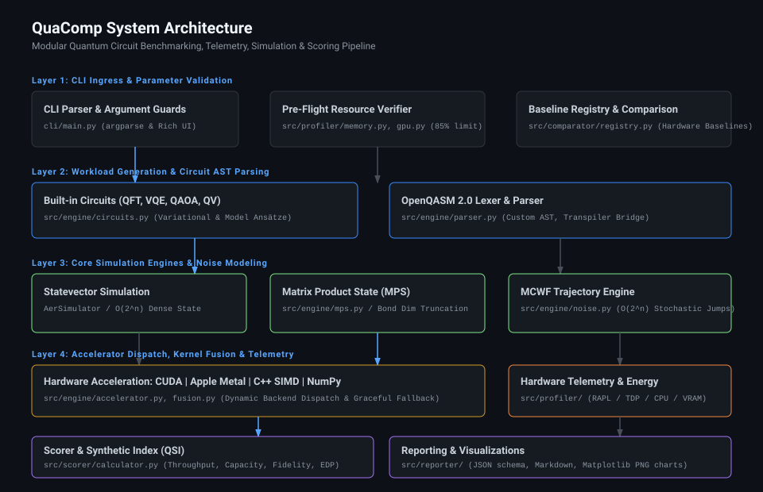

<div align="center">
<pre align="center">
   ____             ____                     
  / __ \__  ______ / ___| ___  _ __ ___  _ __ 
 / / / / / / / __ `/ /   / _ \| '_ ` _ \| '_ \
/ /_/ / /_/ / /_/ / |__| (_) | | | | | | |_) |
\___\_\__,_/\__,_/\____/\___/|_| |_| |_| .__/ 
                                       |_|    
</pre>

# QuaComp

**Quantum Computing Simulation Benchmark on Local Hardware**  
*Profile, stress-test, and benchmark quantum circuit simulations across dense statevector and Matrix Product State (MPS) representations with native GPU/SIMD acceleration, Monte Carlo trajectory noise modeling, and automated memory guards.*

[](https://www.python.org/)
[](https://github.com/cybort18/QuaComp/actions)
[](#running-tests)
[](#running-tests)
[](PRD.md)
[](LICENSE)

</div>

---

## Overview

### What is QuaComp?
QuaComp is an open-source Python CLI benchmarking utility and profiling framework designed to measure the computational limits of quantum circuit simulations on commodity and workstation hardware (CPU, NVIDIA CUDA, Apple Metal, and C++ SIMD).

### What Problem Does It Solve?
Simulating $n$-qubit quantum circuits classically requires tracking state spaces that scale exponentially. Dense statevector simulations require $2^n \times 16$ bytes of RAM, while open-system density matrix models require $4^n \times 16$ bytes. Without pre-flight verification, simulations trigger silent Out-Of-Memory (OOM) operating system kills. QuaComp provides deterministic pre-flight memory guards, robust multi-tier accelerator fallbacks, low-memory Monte Carlo Wavefunction (MCWF) trajectory noise modeling, and standardized performance metrics to evaluate local hardware before scaling workloads to cloud quantum processing units (QPUs).

### How Does a Benchmark Run?
QuaComp verifies available RAM/VRAM against an 85% safety budget, transpiles native or OpenQASM 2.0 circuits, dispatches computation to the fastest available hardware backend with device synchronization, executes multiple statistical runs to calculate latency distributions, and exports machine-readable JSON metrics, Markdown summaries, and 300 DPI telemetry charts.

---

## System Architecture



*For interactive HTML views of all five system diagrams, open [docs/diagrams/index.html](docs/diagrams/index.html) in any browser.*

---

## Quick Start

### 1. Installation
```bash
# Clone the repository
git clone https://github.com/cybort18/QuaComp.git
cd QuaComp

# Install in editable mode
pip install -e .
```
*(If a C++ compiler is detected, the native SIMD extension is automatically compiled; otherwise, QuaComp falls back cleanly to the pure NumPy/CPython implementation).*

### 2. Run Your First Benchmark
```bash
# Execute a quick benchmark across 10, 15, and 20 qubits with automatic telemetry plots
quacomp --quick --chart
```

Benchmark plots are saved at 300 DPI in `results/`:

| Execution Latency Scaling (Mean ± Std Dev) | Memory Footprint & RAM Safety Boundary |
| :---: | :---: |
|  |  |

---

## Key Capabilities & Operational Limits

| Capability | QuaComp Implementation | Operational Limit / Boundary |
| :--- | :--- | :--- |
| **Dense Statevector** | Double-precision complex amplitudes (AerSimulator / NumPy) | Exact O(2^n × 16 B). Practical limit: ~28–30 qubits on 16–32 GB RAM. |
| **Matrix Product State (MPS)** | 1D tensor chain with singular value decomposition (SVD) truncation | Linear O(n · χ^2). Highly accurate for area-law entanglement; fidelity degrades on volume-law states. |
| **Noise Simulation** | Monte Carlo Wavefunction (MCWF) stochastic jump trajectories | O(2^n) memory. Enables simulating noise up to 28 qubits on 16 GB RAM; bypasses the O(4^n) density matrix barrier. |
| **Hardware Acceleration** | Multi-tier: NVIDIA CUDA (`fusion.cu`), Apple Metal (`fusion.metal`), C++ SIMD, NumPy fallback | Graceful fallback hierarchy ensures 100% execution stability across Linux, macOS, and Windows. |
| **Memory Protection** | Pre-flight physical RAM & VRAM guard (85% budget, 90% VRAM headroom) | Automatically halts or skips oversized circuits before memory allocation occurs. |
| **Standard Circuit Input** | Built-in OpenQASM 2.0 lexer and AST parser | Ingests `.qasm` files without external cloud service dependencies. |
| **Hardware Telemetry** | Multi-run latency statistics (Mean, Median, Std), CPU %, Joules | Linux uses direct RAPL microjoule counters; Windows/macOS uses dynamic TDP estimation. |
| **Dual-Mode Scoring** | Logarithmic QuaComp Synthetic Index (QSI) + Formal Academic Suite | QSI ranks hardware tiers; Academic Suite reports kGates/s, Quantum Volume trials, and Energy-Delay Product. |

---

## Architectural & Methodological Diagrams

QuaComp includes dedicated vector schematics covering each core engineering subsystem:

1. **[High-Level Architecture](docs/images/architecture.svg)**: Ingress, AST parsing, core engines, hardware dispatch, and telemetry reporting.
2. **[Benchmark Execution Lifecycle](docs/images/benchmark-workflow.svg)**: Seven-stage execution path from parameter validation to statistical analysis.
3. **[Backend Selection & Fallback](docs/images/backend-selection.svg)**: Automated tier hierarchy checking CUDA, Apple Metal, C++ SIMD, and pure NumPy.
4. **[Statevector vs. Matrix Product State](docs/images/statevector-vs-mps.svg)**: Side-by-side comparison of exponential exact states versus linear tensor trains.
5. **[Noise Simulation Workflow](docs/images/noise-workflow.svg)**: Stochastic MCWF trajectories versus classical density matrix superoperator evolution.

---

## Common CLI Usage

```bash
# 1. Quick Benchmark (10, 15, and 20 Qubits) with Telemetry Charts
quacomp --quick --chart

# 2. Incremental Memory Stress Test (10 Qubits up to RAM Safety Limit)
quacomp --full

# 3. Custom Simulation with NVIDIA CUDA Acceleration
quacomp --custom --qubits 24 --backend cuda

# 4. Monte Carlo Wavefunction Quantum Trajectories (1000 Stochastic Shots)
quacomp --custom --qubits 20 --noise-level medium --noise-method trajectory --shots 1000

# 5. Ingest Real Physical QPU Noise Calibration Snapshot (IBM Brisbane 127Q)
quacomp --quick --noise-profile ibm_brisbane_sample

# 6. Simulate 50-Qubit Low-Entanglement Circuit with Matrix Product State (MPS)
quacomp --custom --qubits 50 --method mps --bond-dim 64

# 7. Benchmark an External OpenQASM 2.0 File
quacomp --qasm benchmarks/bell_state.qasm --runs 3

# 8. Single-Trial Quantum Volume Evaluation (Cross et al. 2019)
quacomp --custom --qubits 4 --qv

# 9. Comparative Performance Diff Against Committed Reference Baseline
quacomp --quick --compare --target apple_m3
```

> *Note: QuaComp CLI can also be executed via module syntax: `python -m cli`.*

---

## Hardware Compatibility & Backend Resolution

QuaComp dynamically probes local compute capabilities and selects the fastest operational backend:

| Hardware Tier | Engine | Runtime Technology | Supported Platforms | Fallback Path |
| :--- | :--- | :--- | :--- | :--- |
| **NVIDIA GPU** | CUDA Acceleration | Native CUDA (`fusion.cu`) via CuPy or PyTorch | Linux, Windows | C++ SIMD → NumPy (CPU) |
| **Apple Silicon** | Metal GPU Compute | Apple Metal Shaders (`fusion.metal`) | macOS (Darwin) | C++ SIMD → NumPy (CPU) |
| **x86_64 / ARM64 CPU** | C++ SIMD Extension | Pybind11 unrolled complex arithmetic | Linux, macOS, Windows | Pure NumPy (CPU) |
| **Generic CPU** | Vectorized NumPy | CPython array operations | All Platforms | Built-in Base Level |

If an explicit backend is requested (e.g., `--backend cuda`) on a machine without matching hardware, QuaComp displays a `[Hardware Notice]` and falls back automatically to the optimal available backend without terminating.

---

## Command Flags Reference

| Flag | Argument / Default | Description |
| :--- | :--- | :--- |
| `--quick` | None | Runs quick benchmark suite across 10, 15, and 20 qubits. |
| `--full` | None | Incremental stress test starting from 10 qubits until memory limit. |
| `--custom` | None | Custom simulation mode with user-defined parameters. |
| `--qubits` | `INT` (default: `10`) | Number of active qubits in the circuit. |
| `--type` | `shallow`, `deep`, `qft`, `vqe`, `qaoa`, `qv` | Workload type (default: `qft`). |
| `--backend` | `auto`, `cuda`, `metal`, `cpp`, `numpy` | Compute accelerator backend with automatic fallback. |
| `--method` | `statevector`, `mps` (default: `statevector`) | Simulation method representation. |
| `--bond-dim` | `INT` (default: `64`) | Maximum bond dimension χ for MPS tensor network engine. |
| `--noise-level` | `none`, `low`, `medium`, `high` | NISQ synthetic noise preset level. |
| `--noise-method` | `trajectory`, `density_matrix` | Noise method: MCWF trajectories (O(2^n)) or Density Matrix (O(4^n)). |
| `--shots` | `INT` (default: `1000`) | Number of stochastic quantum trajectories or measurement shots. |
| `--noise-profile` | `PATH` or alias | Ingest real physical QPU calibration snapshot (e.g. `ibm_brisbane_sample`). |
| `--qasm` | `PATH` | Path to OpenQASM 2.0 file (`.qasm`) to parse and benchmark. |
| `--entropy` | None | Compute bipartite Von Neumann entanglement entropy across cuts. |
| `--compare` | `[FILE1] [FILE2]` | Differential benchmark comparison between JSON runs or against live run. |
| `--target` | `apple_m3`, `ryzen3_5300u`, etc. | Target reference baseline alias or path for comparison. |
| `--fetch-baselines` | None | Synchronize enterprise comparison baselines from registry. |
| `--workers` | `INT` (default: `1`) | Number of parallel worker threads/processes for batch execution. |
| `--runs` | `INT` (default: `3`) | Benchmark iterations per circuit for statistical distribution calculation. |
| `--chart` | None | Generate 300 DPI telemetry PNG charts in `results/`. |
| `--export` | `json`, `md`, `all` (default: `all`) | Report export format. |

---

## Scientific Methodology & Mathematical Foundations

### 1. Monte Carlo Wavefunction (MCWF) Trajectory Noise
Classical density matrix simulation evolves $\rho$ of dimension $2^n \times 2^n = \mathcal{O}(4^n)$, exhausting 16 GB RAM at $n \approx 15$. QuaComp's default noise engine uses the Monte Carlo Wavefunction (MCWF) approach, preserving pure statevectors $|\psi\rangle \in \mathbb{C}^{2^n}$:

For each gate with Kraus operators $\{K_k\}$, branch probabilities are evaluated:

$$p_k = \langle \psi | K_k^\dagger K_k | \psi \rangle$$

- **Jump Branch ($K_1$)**: For amplitude damping with decay parameter $\gamma = 1 - e^{-t_g / T_1}$, if random variable $r < p_{\text{jump}} = \gamma \cdot p_1$, the target qubit collapses from $|1\rangle$ to $|0\rangle$, followed by state renormalization.
- **No-Jump Drift Branch ($K_0$)**: If $r \ge p_{\text{jump}}$, the state undergoes coherent non-unitary drift via $K_0 = \text{diag}(1, \sqrt{1 - \gamma})$, dampening the $|1\rangle$ amplitude followed by state renormalization.

Ensemble expectations are estimated over $N_{\text{shots}}$ independent trajectory paths sampled in parallel:

$$\langle O \rangle = \frac{1}{N_{\text{shots}}} \sum_{s=1}^{N_{\text{shots}}} \langle \psi_s | O | \psi_s \rangle$$

### 2. Matrix Product State (MPS) & Entanglement Limits
MPS factorizes the statevector into a 1D tensor chain:

$$|\psi\rangle \approx \sum_{s_1, \dots, s_n} A^{[1]}_{s_1} A^{[2]}_{s_2} \dots A^{[n]}_{s_n} |s_1 \dots s_n\rangle$$

Bond dimensions are truncated via Singular Value Decomposition (SVD) at $\chi$. Memory scales linearly as $\mathcal{O}(n \cdot \chi^2)$. Bipartite Von Neumann entanglement entropy across a cut $A$ is:

$$S(\rho_A) = -\sum_{i=1}^{\chi} \lambda_i^2 \log_2(\lambda_i^2)$$

When $S(\rho_A) \le \log_2(\chi)$, MPS truncation errors remain minimal ($\epsilon \approx 0$). For volume-law entangled states where $S(\rho_A) \propto n$, truncation introduces approximation errors, and dense statevector simulation is required.

### 3. Scoring Architecture & Academic Metrics
QuaComp implements dual-mode evaluation:
- **QuaComp Synthetic Index (QSI)**: Balanced engineering metric ranking hardware throughput, capacity, and fidelity:

$$\text{QSI} = \text{round}\left( n_{\text{qubits}} \cdot \left[ 100.0 + 50.0 \cdot \log_{10}(\max(T, 1.0)) + 25.0 \cdot \left(\frac{\text{Fidelity}}{100}\right) \right], 2 \right)$$

where $n_{\text{qubits}}$ is the maximum qubit capacity simulated, $T$ is gate throughput in gates/second, and Fidelity is the classical Hellinger fidelity percentage.
- **Quantum Volume Trial ($h_{\text{prob}} > 2/3$)**: Evaluates heavy-output probability for individual square model circuit instances per Cross et al. (2019) with binomial $2\sigma$ lower confidence bounds. *(Note: Commercial quantum volume certification requires aggregating $\ge 100$ independent random circuit instances).*
- **Energy-Delay Product (EDP)**: Figure-of-merit in Joule-seconds ($J \cdot s$) combining execution latency with measured RAPL energy or dynamic TDP power estimates.

---

## Running Tests

QuaComp maintains a 100% test pass rate across all test suites with pytest:

```bash
# Run the complete test suite
python -m pytest tests/

# Measure empirical code coverage across engine and CLI modules
python -m coverage run -m pytest tests/
python -m coverage report --include="src/*,cli/*"
```

### Empirical Test Execution & Coverage Summary

```text
============================= test session starts =============================
platform win32 -- Python 3.13.3, pytest-9.1.1, pluggy-1.6.0
rootdir: QuaComp
configfile: pyproject.toml
collected 205 items

tests\test_accelerator.py .......                                        [  3%]
tests\test_charts.py ....                                                [  5%]
tests\test_comparator.py .......                                         [  8%]
tests\test_cpp_fusion.py ...........                                     [ 14%]
tests\test_cuda.py ..........s............                               [ 25%]
tests\test_energy.py ....                                                [ 27%]
tests\test_engine.py ......                                              [ 30%]
tests\test_entanglement.py ...........                                   [ 35%]
tests\test_gpu.py ...........                                            [ 40%]
tests\test_memory.py .......                                             [ 44%]
tests\test_model_parallelism.py .....                                    [ 46%]
tests\test_mps.py ....                                                   [ 48%]
tests\test_mps_topology.py .....                                         [ 51%]
tests\test_native_integration.py .....                                   [ 53%]
tests\test_noise.py ............                                         [ 59%]
tests\test_parser.py ................................                    [ 75%]
tests\test_physical_noise.py ..........                                  [ 80%]
tests\test_registry.py ...........                                       [ 85%]
tests\test_reporter.py .........                                         [ 89%]
tests\test_scorer.py ...........                                         [ 95%]
tests\test_ui.py ....                                                    [ 97%]
tests\test_variational_qv.py ......                                      [100%]

================== 204 passed, 1 skipped in 62.09s ==================
```

*Statement coverage: **77%** across all source files (3,291 / 4,299 statements executed). Core simulation engines (`circuits.py`, `entanglement.py`, `mps.py`, `noise.py`, `physical_noise.py`, `scorer/calculator.py`, `reporter/charts.py`) achieve 85% to 99% coverage. The single skipped test verifies live NVIDIA CUDA hardware on non-GPU host environments.*

---

## Reference Hardware Baselines

Committed sample baseline profiles are available in `results/registry/` for comparative benchmarking:

| Reference Platform | Memory | Device | Category | Sample Baseline Profile |
| :--- | :---: | :---: | :---: | :--- |
| **AMD Ryzen 3 5300U** | 11.33 GB DDR4 | CPU | Entry-Level Laptop | [`example_ryzen3_5300u.json`](results/registry/example_ryzen3_5300u.json) |
| **AMD Ryzen 7 5800H** | 16.00 GB DDR4 | CPU | High-End Laptop | [`example_ryzen7_5800h.json`](results/registry/example_ryzen7_5800h.json) |
| **Apple M3 (8-core)** | 24.00 GB Unified | CPU / Metal | High-End Laptop | [`example_apple_m3.json`](results/registry/example_apple_m3.json) |
| **Apple M4 Max** | 128.00 GB Unified | Metal | Workstation | [`example_apple_m4_max.json`](results/registry/example_apple_m4_max.json) |
| **AWS Graviton4** | 32.00 GB | CPU | Cloud Instance | [`example_aws_graviton4.json`](results/registry/example_aws_graviton4.json) |
| **NVIDIA H100 (80GB)** | 80.00 GB HBM3 | CUDA | Enterprise GPU | [`example_nvidia_h100.json`](results/registry/example_nvidia_h100.json) |

*These profiles represent committed reference fixtures used for differential comparisons with `--compare`.*

---

## Project Structure

```text
QuaComp/
├── benchmarks/             # OpenQASM 2.0 benchmark circuits (Bell, GHZ, QFT, Teleportation)
├── cli/                    # CLI interface, argument parser, runners, and comparison engine
├── docs/
│   ├── diagrams/           # HTML previews for system architecture and workflows
│   └── images/             # Vector diagrams (SVG) and telemetry plot figures (PNG)
├── results/
│   ├── noise_profiles/     # Ingested hardware noise snapshots (e.g. IBM Brisbane 127Q)
│   └── registry/           # Committed reference hardware baseline profiles
├── src/
│   ├── comparator/         # Differential benchmark comparison engine and baseline registry
│   ├── engine/             # Quantum simulation core (Statevector, MPS, MCWF Trajectories, CUDA, Metal, C++)
│   ├── profiler/           # Hardware telemetry (memory pre-flight guards, energy profiler, GPU detector)
│   ├── reporter/           # JSON/Markdown exporters and 300 DPI Matplotlib chart generator
│   └── scorer/             # QSI heuristic calculator and formal academic metrics
└── tests/                  # 22 test suites covering 205 test cases
```

---

## Contribution Guide & License

Contributions are welcome. When submitting pull requests:
1. Ensure all changes adhere to the repository guidelines in [AGENTS.md](AGENTS.md) and [GEMINI.md](GEMINI.md).
2. Maintain zero emojis / emotes across code, comments, CLI output, and documentation.
3. Ensure 100% test pass rate (`python -m pytest tests/`).
4. Avoid introducing unescaped LaTeX matrix environments into inline text or Markdown tables.

For full architectural requirements and product design specifications, consult the [Product Requirement Document (PRD.md)](PRD.md).

QuaComp is licensed under the **MIT License** — see [LICENSE](LICENSE) for details.
