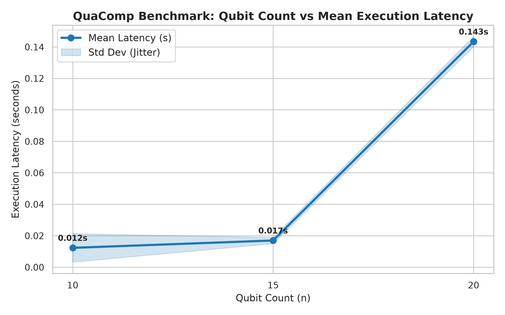
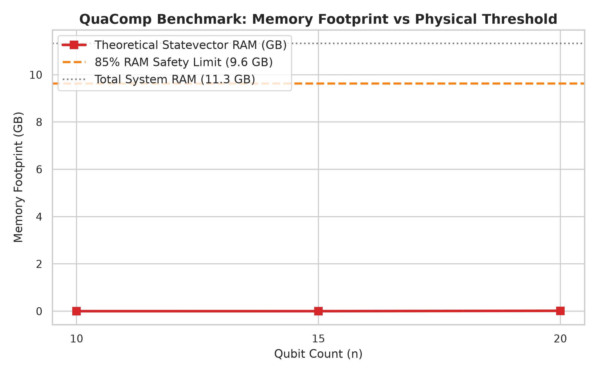
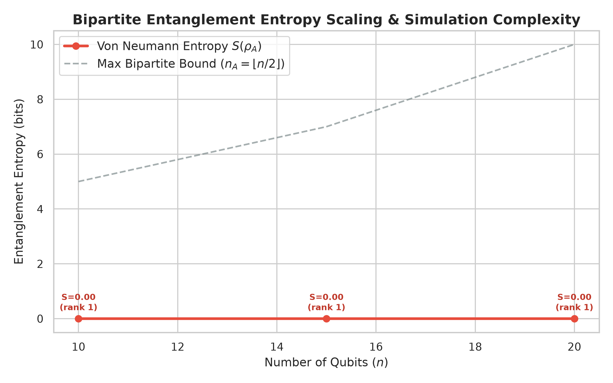

# QuaComp Benchmark Report
Generated on: `2026-10-16 15:01:56`

---

## Benchmark Summary
### Hardware Benchmark Overview (QuaComp Synthetic Index)
| Benchmark Metric | Measured Value | Performance Tier / Status |
| :--- | :---: | :---: |
| **QuaComp Synthetic Index (QSI)** | `1,128.82` pts | **Entry-Level** |
| **Capacity Metric (2^n)** | `16` | Max `4` qubits simulated |
| **Throughput Metric** | `1,393.47 gates/s` | Dynamic sensitivity scale |
| **Execution Latency (Mean)** | `0.0086s` | ± `0.0000s` (1 runs) |
| **Simulation Method** | `MPS (chi=64)` | Acceleration: Standard CPU |

### Formal Academic Metrics (Quantum HPC Standards)
| Academic Metric | Measured Value | Standard / Significance |
| :--- | :---: | :--- |
| **Normalized Gate Throughput** | `1.3935 kGates/s` | `12` total gates processed |
| **Effective Memory Bandwidth** | `0.0007 GB/s` | Arithmetic Intensity: `0.4375 FLOPs/Byte` (Memory-bound) |
| **Energy-Delay Product (EDP)** | `0.002144 J · s` | Energy-delay efficiency (Lower indicates superior efficiency) |
| **Quantum Volume Certification** | `Not Evaluated` | Heavy Output Probability: `N/A` (Threshold: > 0.6667) |
| **Quantum State Fidelity** | `100.00%` | Statevector fidelity against ideal analytical target |

---

> **MPS RAM Efficiency:** `0.00%` savings (Saved ~`0.0000 GB` vs Statevector)
> **MPS SVD Fidelity:** `100.0000%` (Truncation Error: `0.00e+00` | Active Bond: `1` | SWAPs: `16`)
> **Hardware Energy Telemetry:** `[Sensor: TDP Estimate]` `0.2490 J` (Avg Power: `3.58 W`, EQO: `20748.52 µJ/gate | `Windows Dynamic TDP Model`)

---

## System Metadata & Telemetry
| Parameter | System Value |
| :--- | :--- |
| **CPU Name** | AMD Ryzen 3 5300U with Radeon Graphics |
| **Total Physical RAM** | 11.33 GB |
| **Operating System** | Windows (11) |
| **Python Version** | 3.13.3 |

---

## Detailed Simulation Runs
| Qubits | Method | Noise Profile | Workload | Total Gates | Latency (Mean ± Std Dev) | Fidelity % | Avg CPU % | RAM Status | Success |
| :---: | :--- | :--- | :--- | :---: | :---: | :---: | :---: | :---: | :---: |
| 4 | mps (chi=64) | none | QFT | 12 | 0.0086 ± 0.0000s | 100.00% | 10.2% | SAFE | SUCCESS |

---

## Matrix Product State (MPS) Tensor Telemetry
| Qubits | Workload | Max Bond Dim (χ) | Active Bond (χ_act) | SVD Fidelity | Truncation Error (ε) | SWAP Count | RAM Savings vs SV |
| :---: | :---: | :---: | :---: | :---: | :---: | :---: | :---: |
| 4 | QFT | 64 | 1 | 100.0000% | 0.00e+00 | 16 | 0.0% |

---

## Hardware Power & Energy Telemetry (EQO)
| Qubits | Workload | Avg Power (W) | Total Energy (J) | EQO (µJ/Gate) | Telemetry Backend & Source |
| :---: | :---: | :---: | :---: | :---: | :--- |
| 4 | QFT | 3.58 W | 0.2490 J | 20748.52 µJ | `[Sensor: TDP Estimate]` Windows Dynamic TDP Model |

---

## Telemetry Visualizations

---

## GitHub Ready
This report is formatted and ready to be posted directly into GitHub Issues, pull request reviews, or Discussions.