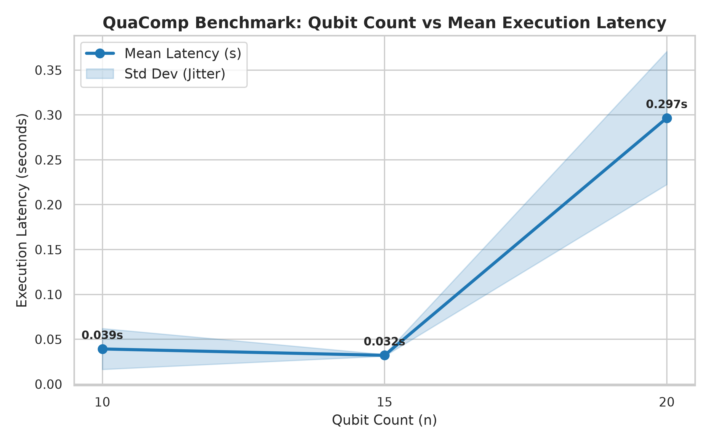
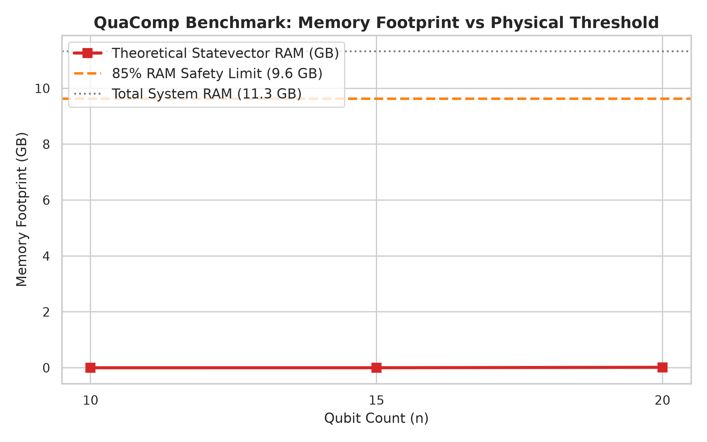

# QuaComp Benchmark Report
Generated on: `2026-11-01 16:38:20`

---

## Benchmark Summary
### Hardware Benchmark Overview (QuaComp Synthetic Index)
| Benchmark Metric | Measured Value | Performance Tier / Status |
| :--- | :---: | :---: |
| **QuaComp Synthetic Index (QSI)** | `5,370.24` pts | **Mid-Range** |
| **Capacity Metric (2^n)** | `1,048,576` | Max `20` qubits simulated |
| **Throughput Metric** | `741.71 gates/s` | Dynamic sensitivity scale |
| **Execution Latency (Mean)** | `0.2966s` | ± `0.0741s` (3 runs) |
| **Simulation Method** | `Statevector` | Acceleration: Standard CPU |

### Formal Academic Metrics (Quantum HPC Standards)
| Academic Metric | Measured Value | Standard / Significance |
| :--- | :---: | :--- |
| **Normalized Gate Throughput** | `0.7417 kGates/s` | `220` total gates processed |
| **Effective Memory Bandwidth** | `24.8877 GB/s` | Arithmetic Intensity: `0.4375 FLOPs/Byte` (Memory-bound) |
| **Energy-Delay Product (EDP)** | `5.391897 J · s` | Energy-delay efficiency (Lower indicates superior efficiency) |
| **Quantum Volume Certification** | `Not Evaluated` | Heavy Output Probability: `N/A` (Threshold: > 0.6667) |
| **Quantum State Fidelity** | `100.00%` | Statevector fidelity against ideal analytical target |

---

> **Quantum Observables & Entanglement:** `S(rho_A) = 0.0000 ebits` | `<Z_0 Z_(n-1)> = 0.0000` | `<H_Ising> = 0.0000`
> **Hardware Energy Telemetry:** `[Sensor: TDP Estimate]` `18.1783 J` (Avg Power: `8.73 W`, EQO: `82628.84 µJ/gate | `Windows Dynamic TDP Model`)

---

## System Metadata & Telemetry
| Parameter | System Value |
| :--- | :--- |
| **CPU Name** | AMD Ryzen 3 5300U with Radeon Graphics |
| **Total Physical RAM** | 11.33 GB |
| **Operating System** | Windows (11) |
| **Python Version** | 3.13.3 |

---

## Detailed Simulation Runs
| Qubits | Method | Noise Profile | Workload | Total Gates | Latency (Mean ± Std Dev) | Fidelity % | Avg CPU % | RAM Status | Success |
| :---: | :--- | :--- | :--- | :---: | :---: | :---: | :---: | :---: | :---: |
| 10 | statevector | none | QFT | 60 | 0.0392 ± 0.0228s | 100.00% | 91.4% | SAFE | SUCCESS |
| 15 | statevector | none | QFT | 127 | 0.0321 ± 0.0010s | 100.00% | 66.1% | SAFE | SUCCESS |
| 20 | statevector | none | QFT | 220 | 0.2966 ± 0.0741s | 100.00% | 84.3% | SAFE | SUCCESS |

---

## Circuit Complexity & Auto-Solver Routing
| Qubits | Workload | Clifford Gates | Non-Clifford Gates | Magic Density | Max Interaction Dist | Entanglement Topology | Selected Solver |
| :---: | :---: | :---: | :---: | :---: | :---: | :---: | :---: |
| 10 | QFT | 15 | 45 | 0.7500 | 9 | all_to_all_long_range | `statevector` |
| 15 | QFT | 22 | 105 | 0.8268 | 14 | all_to_all_long_range | `statevector` |
| 20 | QFT | 30 | 190 | 0.8636 | 19 | all_to_all_long_range | `statevector` |

---

## Quantum Observables & Bipartite Entanglement
| Qubits | Workload | Solver | Precision | Bipartite Entanglement Entropy | ZZ Correlation ⟨Z_0 Z_(n-1)⟩ | Ising Energy Expectation ⟨H_Ising⟩ |
| :---: | :--- | :---: | :---: | :---: | :---: | :---: |
| 10 | QFT | statevector | fp64 | 0.0000 ebits | +0.0000 | +0.0000 |
| 15 | QFT | statevector | fp64 | 0.0000 ebits | +0.0000 | +0.0000 |
| 20 | QFT | statevector | fp64 | 0.0000 ebits | +0.0000 | +0.0000 |

---

## Hardware Power & Energy Telemetry (EQO)
| Qubits | Workload | Avg Power (W) | Total Energy (J) | EQO (µJ/Gate) | Telemetry Backend & Source |
| :---: | :---: | :---: | :---: | :---: | :--- |
| 10 | QFT | 10.61 W | 16.3627 J | 272711.30 µJ | `[Sensor: TDP Estimate]` Windows Dynamic TDP Model |
| 15 | QFT | 9.82 W | 15.1987 J | 119674.84 µJ | `[Sensor: TDP Estimate]` Windows Dynamic TDP Model |
| 20 | QFT | 8.73 W | 18.1783 J | 82628.84 µJ | `[Sensor: TDP Estimate]` Windows Dynamic TDP Model |

---

## Telemetry Visualizations

---

## GitHub Ready
This report is formatted and ready to be posted directly into GitHub Issues, pull request reviews, or Discussions.